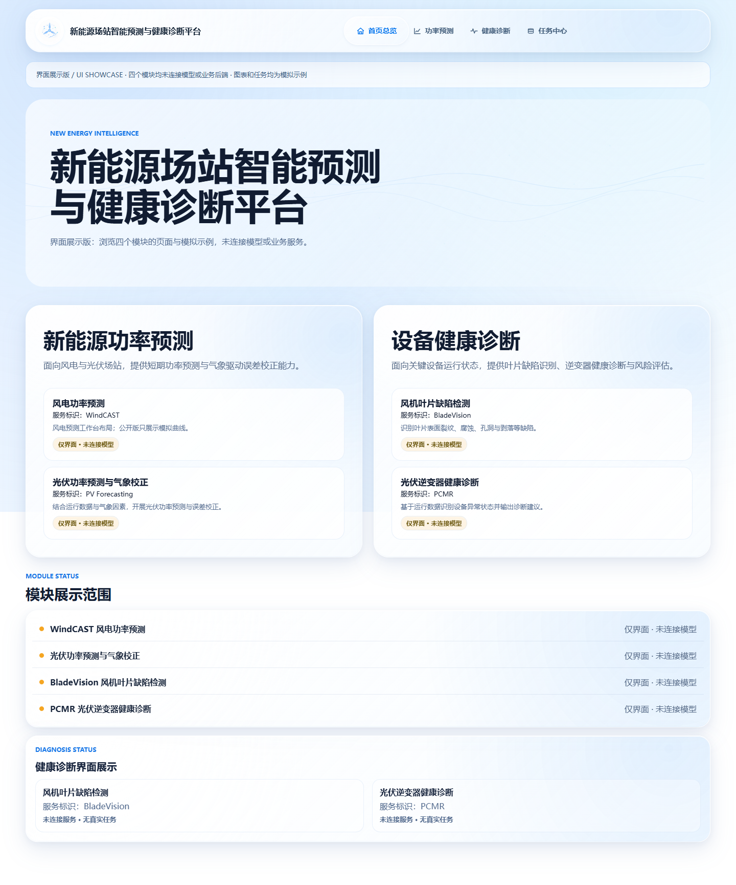
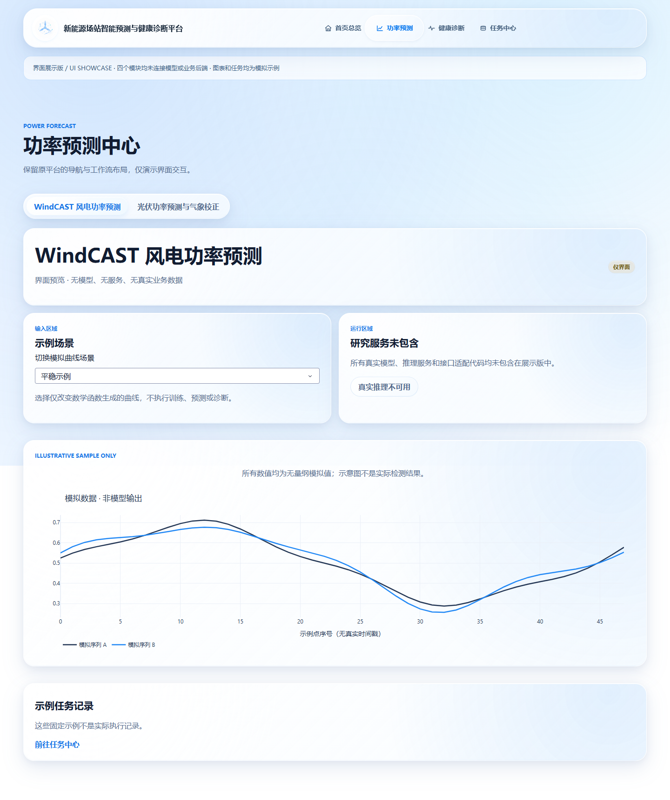

# Renewable Energy Platform — UI Showcase

A standalone interface showcase for the **Renewable Energy Forecasting and Condition Diagnosis Platform**. It preserves the platform's visual language, navigation, overview, and workflow presentation while replacing all four model integrations with explicitly labeled illustrative examples.

**This is a presentation-only edition, not the complete research system. None of the four models or their business backend services are included or called.**

## My contribution

As the project author, **Shuyu Liu**, my contribution to the original platform includes:

- **WindCAST:** the wind-power forecasting research work and its integration into the platform.
- **Frontend interface:** the platform-wide interface design and implementation, including the overview, navigation, forecasting and diagnostic workspaces, visualization layouts, and task-center interface.
- **Frontend integration:** connecting the module experiences to the unified frontend and presenting their inputs, workflow states, and results.

The contribution to the other three modules described here is the platform frontend and frontend integration. Their model development is outside this personal contribution statement. The WindCAST research implementation is also not distributed in this public-facing edition.

## Four interface modules

| Interface | What this edition displays | What it does not include |
| --- | --- | --- |
| Wind-power forecasting | Workspace layout and synthetic curves | WindCAST implementation, training, checkpoints, inference, research data, and experimental outputs |
| Photovoltaic forecasting | Forecasting workspace and synthetic curves | PV models, preprocessing, weather correction, trained artifacts, and inference services |
| Blade defect detection | Workspace and an authored blade schematic with a fixed example box | Detection models, image processing, weights, real inspection images, and detection services |
| Inverter condition analysis | Diagnostic workspace and synthetic curves | PCMR or other diagnostic models, preprocessing, trained artifacts, operating data, and backend services |

All displayed charts are deterministic mathematical illustrations. They are not predictions, measurements, diagnostic findings, benchmark scores, or paper results. Task-center rows are fixed sample records; they do not represent jobs that were executed.

## Included interactions

- Navigation between the overview, two forecasting interfaces, two diagnostic interfaces, and task center.
- Module tabs and links from sample task rows to their corresponding workspaces.
- A scenario selector that switches between two invented curve shapes.
- The original platform's shared styling, animated overview background, and navigation treatment.

There is no data upload, database, persistent task store, model loader, training command, business API, or private-directory lookup. Real-inference controls are visibly disabled. Clearing or refreshing the page does not affect any research system.

## Run locally

Python 3.10 or newer is required.

```bash
git clone https://github.com/liushuyu1925-wq/renewable-platform-ui.git
cd renewable-platform-ui
```

```powershell
python -m venv .venv
.venv\Scripts\Activate.ps1
python -m pip install -r requirements.txt
python app.py
```

On Linux or macOS, activate the environment with `source .venv/bin/activate`.

Open http://127.0.0.1:8061. Dash provides the local presentation server and UI callbacks only; it is not one of the original model or business backend services. No credentials, external AI accounts, model files, or research datasets are required.

The original interface labels remain in Chinese. This README is in English.

## Interface previews

These screenshots were captured from this standalone showcase. All visible charts and task records are illustrative examples.





## Routes

| Route | Interface |
| --- | --- |
| `/overview` | Platform overview |
| `/prediction/windcast` | Wind-power interface |
| `/prediction/pv` | Photovoltaic interface |
| `/diagnosis/blade` | Blade-detection interface |
| `/diagnosis/inverter` | Inverter-diagnostic interface |
| `/tasks` | Sample task center |

## Repository scope

```text
app.py                 Presentation routing and callbacks
ui/config.py           Navigation and showcase status
ui/navigation.py       Platform navigation components
ui/overview.py         Overview presentation
ui/samples.py          Invented chart and task fixtures
assets/                Styles, icon, visual animation, and blade schematic
requirements.txt       Presentation dependencies
```

The four original integration adapters, their service clients, model code, weights, raw and processed datasets, research configuration files, databases, logs, and experimental artifacts are deliberately excluded. This interface package must not be described as the complete runnable forecasting or diagnostic system.

## Checks

```powershell
python -m unittest discover -s tests -v
```

The checks cover the presentation-only import boundary, synthetic fixtures, and page routing. They do not evaluate the original models or reproduce any research result.

### Verified for this edition

- Five automated checks passed with Python 3.13.9, Dash 4.3.0, and Plotly 6.3.0.
- All six primary pages were checked in Edge at 1440-pixel and 390-pixel viewport widths.
- Navigation, module tabs, scenario selection, and sample-task links were exercised.
- The checked flows had no horizontal page overflow, clipped navigation, browser-console errors, failed network responses, or requests to external services.
- The publication files were checked for model artifacts, original dataset files, database files, private directory references, and common credential patterns.

These checks validate the interface showcase only. Real forecasting, detection, diagnosis, backend integration, and research reproducibility are outside this edition.
